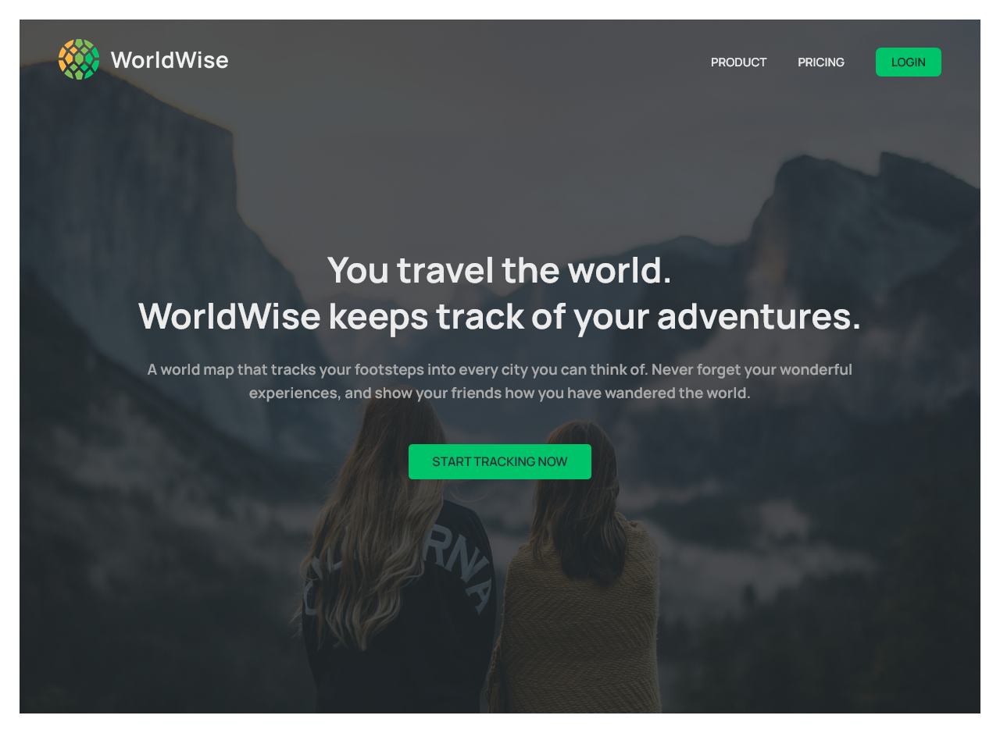

# WorldWise App

A travel journal app that lets users explore an interactive world map, track the cities they've visited, and save visit dates and personal notes.

**[Live Demo](https://world-wise-app-delta.vercel.app/)**



## Table of Contents

1. [Features](#features)
2. [Tech Stack](#tech-stack)
3. [How It Works](#how-it-works)
4. [Project Structure](#project-structure)
5. [Getting Started (How to Use)](#getting-started-how-to-use)
6. [Build](#build)
7. [Contributions (Adding Your Own Features)](#contributions-adding-your-own-features)
8. [License & Author](#license--author)

## Features

- Interactive world map powered by Leaflet and OpenStreetMap.
- Add a city by clicking its location on the map.
- Automatically retrieve city and country information from the selected coordinates using reverse geocoding.
- Save each visited city's name, country, flag, visit date, geographic coordinates, and personal notes.
- View saved cities in a list and explore them by country.
- Display map markers for saved cities.
- Use the browser's Geolocation API to find and navigate to your current location.
- View individual city details, including the visit date and notes.
- Delete cities from your travel journal.
- Protected application routes with a demo login flow.
- Persist the city list and demo login state in the browser using `localStorage`.
- Responsive layouts for desktop, tablet, and mobile screens.

## Tech Stack

- React 18 (Create React App)
- React Router DOM for client-side routing and protected routes
- Context API and `useReducer` for shared state management
- `useEffect` and `useCallback` for side effects and memoized functions
- React-Leaflet and Leaflet for interactive maps
- OpenStreetMap for map tiles
- Nominatim for reverse geocoding
- Browser Geolocation API for retrieving the user's current location
- `localStorage` for browser-side data persistence
- React DatePicker for selecting visit dates
- CSS Modules and plain CSS for styling and responsive layouts
- Deployed on Vercel

## How It Works

The application is organized around React Router and two context providers: `AuthContext` and `CitiesContext`.

- `AuthContext` manages the demo user's login state. The user profile is saved in `localStorage` so the login state remains available after refreshing the page.
- `CitiesContext` manages the cities list, loading state, selected city, and city operations through `useReducer`.
- When the app starts, `CitiesContext` first checks `localStorage` for previously saved cities. If no saved list exists, it fetches the initial dataset from `public/cities.json` and stores a copy in the browser.
- Clicking a location on the map navigates to the form with the selected latitude and longitude in the URL query parameters.
- The form sends those coordinates to the Nominatim reverse-geocoding service to retrieve the city and country information.
- When the form is submitted, the new city is added to the shared cities state and the updated list is saved in `localStorage`.
- Deleting a city updates the shared state and the browser's saved list.
- The map displays markers based on the saved cities. The Geolocation API can also be used to move the map to the user's current position.
- `ProtectedRoute` checks the authentication state before displaying the main application layout.

**Storage note:** This version uses a static JSON file as its initial dataset and `localStorage` for changes made by the user. It does not use a backend database, so saved cities are local to the current browser and are not synchronized across devices or users.

**Demo authentication note:** The login is a client-side demo using hardcoded credentials. It is intended for demonstration purposes only and is not secure authentication.

### Demo Login

The login form is prefilled with the demo credentials:

```text
Email:    ahmed@example.com
Password: qwertyy
```

## Project Structure

```text
public/
  cities.json              # Initial city dataset
  imgs/                    # Public images and logo
  index.html

src/
  App.js                   # Providers and application routes
  index.js                 # React entry point
  index.css                # Global styles
  Components/
    Button.js
    City.js
    CityItem.js
    CityList.js
    CountryItem.js
    CountryList.js
    Form.js
    LayoutNav.js
    Logo.js
    Map.js
    Message.js
    Nav.js
    Sidebar.js
    Spinner.js
    User.js
    *.module.css           # Component styles
  contexts/
    AuthContext.js         # Demo authentication state
    CitiesContext.js       # Cities state and operations
  hooks/
    useGeolocation.js      # Browser geolocation custom hook
  Pages/
    Home.js
    Layout.js
    Login.js
    NotFound.js
    Pricing.js
    Product.js
    ProtectedRoute.js
    *.module.css           # Page styles
```

## Getting Started (How to Use)

Clone the repository and install its dependencies:

```bash
git clone <https://github.com/Ahmed-Abdlhameed/WorldWise-App.git>
cd WorldWise
npm install
npm start
```

The app runs at [http://localhost:3000](http://localhost:3000).

1. Open the app and select **Start tracking now**.
2. Log in using the demo credentials above.
3. Open the map and click a location you want to add to your travel journal.
4. Review the detected city and country, choose the visit date, and add notes.
5. Save the city to see it in your city list and on the map.
6. Explore the countries list or open a city to view its details.
7. Use the delete button to remove a city from your journal.

The browser may ask for permission when you use the **Use your position** feature.

## Build

```bash
npm run build
```

This creates an optimized production build in the `build/` folder.

## Contributions (Adding Your Own Features)

Feel free to fork the repository and contribute by improving the app, fixing bugs, or adding new features. Pull requests are welcome!

Some ideas for future improvements:

- Add a backend and database for persistent, account-based travel journals.
- Replace the demo login with a secure authentication solution.
- Synchronize saved cities across devices.
- Add editing functionality for existing city entries.
- Improve form validation and geocoding error handling.

## License & Author

This repository is for personal learning and portfolio purposes. No separate license file is currently included. Built by **Ahmed Abdelhameed**. Find me on [GitHub](https://github.com/Ahmed-Abdlhameed).
